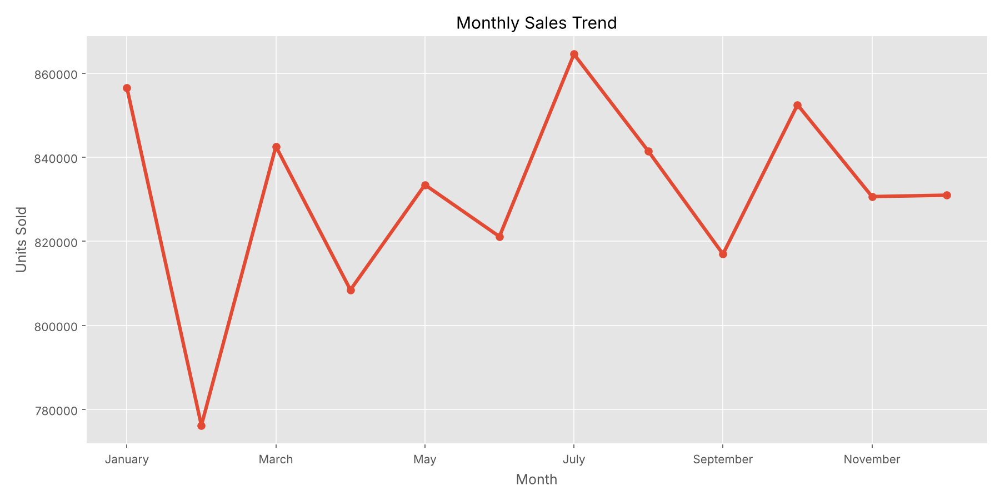
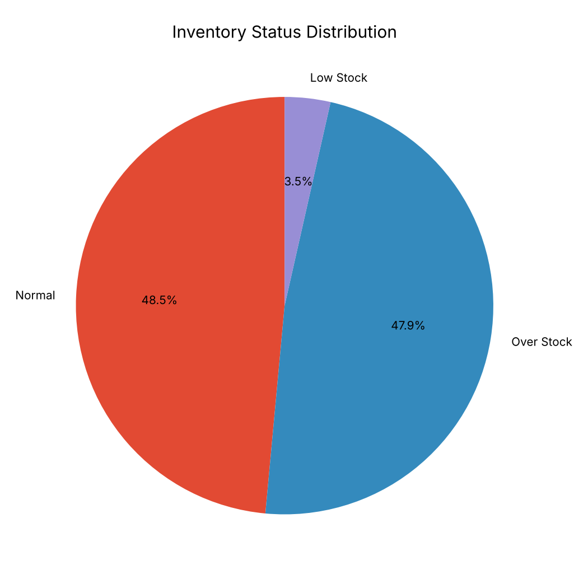
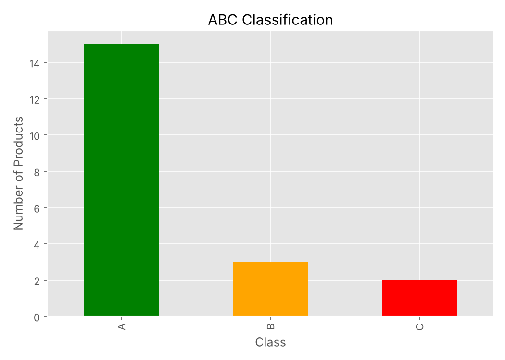
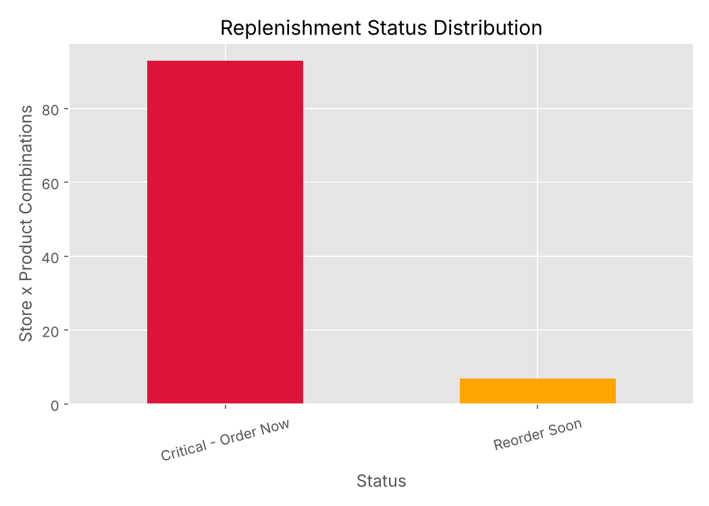

# 📦 Retail Inventory Analysis & Replenishment Planning

A Python analysis of two years of daily retail data that measures sales performance, inventory health, and demand forecast accuracy, then turns the findings into a concrete **replenishment and procurement plan** (safety stock, reorder point, EOQ).

## 📌 Overview
| | |
|---|---|
| **Dataset** | 73,100 daily records · 5 stores × 20 products × 4 regions · Jan 2022 – Jan 2024 |
| **Tools** | Python (pandas, NumPy, Matplotlib, Seaborn), Excel (openpyxl) |
| **Outputs** | 16 charts, a multi-sheet Excel report, and a replenishment plan CSV |

## 🔍 What the Analysis Does
1. **Data cleaning and validation:** checks types, missing values, and duplicates (none found).
2. **Feature engineering:** 15 original columns → 27, including revenue, revenue after discount, forecast error, inventory turnover, and inventory status.
3. **EDA:** sales and revenue by category, region, season, and month; top products; discount and price effects.
4. **KPI analysis:** revenue, units, turnover, stock levels, and forecast accuracy.
5. **Correlation analysis** between sales, inventory, pricing, and demand drivers.
6. **ABC classification** of products by revenue contribution.
7. **Replenishment plan** for all 100 store-product combinations, using the most recent 90 days of demand:
   - **Safety stock** at a 95% service level (Z = 1.65)
   - **Reorder point** with a 7-day supplier lead time
   - **EOQ** (economic order quantity) from ordering and holding costs
   - **Days of supply**, replenishment status, suggested order quantity, and estimated cost

> Lead time, service level, and cost figures are not in the dataset, so they are clearly stated **business assumptions** at the top of the script and easy to change.

## 📊 Key Results
| KPI | Value |
|---|---|
| Total revenue | $550.2M ($495.0M after discounts) |
| Units sold | 9.98M |
| **Demand forecast accuracy** | **94.11%** |
| Overstock share of records | 47.9% |
| Low-stock share of records | 3.5% |
| Best region / category / season | East / Furniture / Autumn |
| Store-product items needing an immediate order | 93 of 100 |
| Estimated procurement needed | $9.77M |

**Main takeaway:** demand forecasting is reliable, but nearly half of the records show overstock, so the biggest opportunity is inventory optimization rather than better forecasting.

<p align="center">
  
  
</p>
<p align="center">
  
  
</p>

All 16 charts are in the [`charts/`](charts) folder, the full plan is in [`outputs/Replenishment_Plan.csv`](outputs/Replenishment_Plan.csv), and the Excel report with every KPI and analysis sheet is in [`reports/Retail_Inventory_Report.xlsx`](reports/Retail_Inventory_Report.xlsx).

## ▶️ How to Run
```bash
pip install pandas numpy matplotlib seaborn openpyxl
python inventory_analysis.py
```
The script reads `data/retail_store_inventory.csv` and writes the charts to `charts/` and the cleaned dataset, Excel report, and replenishment plan to `outputs/` (~1 minute).

## 📁 Project Structure
```
├── inventory_analysis.py          # Full analysis script
├── data/
│   └── retail_store_inventory.csv # Raw dataset
├── charts/                        # 16 generated charts
├── outputs/
│   └── Replenishment_Plan.csv     # Replenishment plan per store-product
└── reports/
    ├── Retail_Inventory_Analysis_Report.pdf  # Management summary
    └── Retail_Inventory_Report.xlsx          # Excel report: KPIs, insights, ABC, correlation, replenishment plan
```

## 👤 Author
**Waseem Mahmoud** · [LinkedIn](https://www.linkedin.com/in/waseem-mahmoud-a34154213) · [GitHub](https://github.com/waseemalali)
